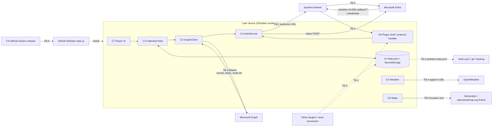

# Threat Model — M365 Calendar for Obsidian

| | |
|---|---|
| **Method** | STRIDE per component and trust boundary, backed by an active threat hunt (every "Confirmed" finding was reproduced with a PoC in this run; the PoC registry is summarised in §9) |
| **Version reviewed** | `0.29.6` (`manifest.json`) |
| **CODE_PIN** | `f88e7b49b10b7ca98f610e9c3835e94260fae5cd` (branch `master` at the time of review; all `file:line` citations are against this commit) |
| **Review date** | 2026-10-25 |
| **Mode** | CREATE (first model) |
| **Status** | Draft for review — not merged without maintainer approval. **Public edition:** exact payloads and PoC harness sources are withheld until the corresponding fixes ship; the unredacted version is held privately by the maintainer |
| **Scope** | Plugin source (`src/`), build/CI/release (`.github/`, `esbuild.config.mjs`), install scripts (`scripts/`). Out of scope: Obsidian itself, Microsoft Entra/Graph, OpenWeather, OpenStreetMap services, and the user's Azure app registration. |

---

## 1. How to use this document

**Purpose.** Engineers consult this before changing anything that touches credentials, network calls, persisted data, rendering of remote content, or the release pipeline. It records what an attacker could do, what was actually demonstrated, and what is still open.

### 1.1 When you MUST update it

| Change type | Re-read / update |
|---|---|
| New or changed **sink** that renders remote text as markup (`innerHTML`, `dangerouslySetInnerHTML`, `MarkdownRenderer`, `createEl` with HTML) | T-4, V-5 |
| New **endpoint, host, or URL built from remote data** (new `fetch`/`requestUrl`, new `nextLink`-like cursor) | T-1, T-2, T-3, V-2, V-3 |
| New OAuth **scope**, new Azure app/tenant handling, change to the sign-in flow or the `obsidian://` handler | S-1, S-3, D-2, I-2, V-1, V-4 |
| New **persisted data** (anything written through `saveData`, SecretStorage, files in the vault) | I-1, T-8, V-6 |
| New **launch/open/write capability** (`shell.openExternal`, opening links, writing files, spawning processes) | E-6, T-6 |
| Any **CI, release, or build** change (workflows, esbuild config, scripts) | E-1 … E-4, V-9 |
| New **dependency** with install scripts, native code, or that is bundled into `main.js` | E-7, §5.4 |
| New **automatic outbound fetch** triggered by content (map embeds, images, link previews) | I-4, I-7, V-7 |
| **Relaxing a control** listed in §6 | §6, §7 |

**PR rule.** Every PR description includes one line: `Threat model: no impact` or `Threat model: updated (IDs)`.

### 1.2 Rating scale (likelihood × impact)

| Rating | Meaning |
|---|---|
| **Critical** | Likely and leads to account takeover / code execution with no unusual precondition |
| **High** | Either likely with serious impact, or serious impact with a precondition that is realistic for ordinary users |
| **Medium** | Serious impact but needs a precondition outside the plugin (e.g. writable vault config, network position, compromised pipeline), or moderate impact that is easily reached |
| **Low** | Limited impact, or needs several unlikely preconditions, or only affects a trusted-contributor path |

When impact is high but a precondition is required, the finding says so in "Who can exploit it".

### 1.3 Status vocabulary

`Confirmed` reproduced in this run with a PoC · `Reasoned` found by reading code, not exercised · `Mitigated` a control exists and was checked · `Accepted` inherited from platform or deliberate trade-off (owner named) · `Disproved` hypothesis tested and did not hold.

---

## 2. System overview

**What it is.** An Obsidian community plugin (desktop and mobile, `isDesktopOnly: false`) that renders a Microsoft 365 calendar and To Do tasks inside Obsidian. It signs in with OAuth 2.0 authorization code + PKCE against Microsoft Entra using a **user-supplied Azure app registration** (client ID / tenant ID entered in settings), calls Microsoft Graph with the resulting bearer token, caches results in the plugin's `data.json`, optionally calls OpenWeather (API key in settings) and OpenStreetMap (Nominatim geocoding + an `<iframe>` embed).

**Runtime context.** The plugin runs in Obsidian's renderer with the privileges of the Obsidian process; Obsidian does not sandbox community plugins (AS-2). Users are individuals who install via BRAT or a GitHub release; vaults are frequently synced (Obsidian Sync, iCloud, git, Dropbox).

### 2.1 Assets

| ID | Asset | Why it matters |
|---|---|---|
| A1 | Entra access + refresh tokens (`Calendars.ReadWrite.Shared`, `Tasks.ReadWrite`, `User.Read`, `offline_access`) | Read/modify/delete the user's calendar and tasks for up to 90 days sliding |
| A2 | Calendar and task content (subjects, bodies, locations, attendees' data) | Confidential business/personal information; integrity of what the user sees |
| A3 | OpenWeather API key | Billing/quota abuse (low value) |
| A4 | Trust in the Azure app identity (which `client_id` the user consents to) | A hostile app registration obtains the same scopes |
| A5 | Vault integrity (notes, other plugins' data) | Collateral damage from scripts and shared plugin runtime |
| A6 | Integrity of the released `main.js` | Every installer runs it with full Obsidian privileges |
| A7 | User location/meeting-place privacy | Location strings are sent to third parties when maps are on |

### 2.2 Adversaries

| ID | Adversary | Capability |
|---|---|---|
| X1 | Remote, unauthenticated invite sender | Can place text (subject, body, location, coordinates) into the victim's calendar via invitations |
| X2 | Network attacker / TLS-intercepting proxy | Can alter or observe HTTPS traffic if a trusted CA is installed or a proxy is in path |
| X3 | Co-resident code: another Obsidian plugin or local process | Reads/writes vault files; same renderer privileges |
| X4 | Vault-content attacker | Can influence files inside a vault the victim opens (shared git vault, synced folder, downloaded vault) including `.obsidian/plugins/m365-calendar/data.json` |
| X5 | Compromised upstream | Malicious npm package, hijacked GitHub Action tag, compromised OpenWeather/Nominatim response |
| X6 | Malicious or compromised contributor | Can land code/config or alter workflows via PR or stolen credentials |
| X7 | Phisher / social engineer | Can make a victim open an `obsidian://` link or approve a consent prompt |
| X8 | Device thief | Has the unlocked or offline device/disk |

### 2.3 Components

| ID | Component | Files |
|---|---|---|
| C1 | Auth (PKCE, token store/refresh, callback) | `src/services/AuthService.ts` |
| C2 | Graph client + retry | `src/services/GraphClient.ts`, `src/lib/fetchWithRetry.ts` |
| C3 | Calendar/Todo services | `src/services/CalendarService.ts`, `TodoService.ts` |
| C4 | Persistence (`data.json`: settings + caches) | `src/main.ts`, `CacheService.ts`, `TaskCacheService.ts`, `WeatherCacheService.ts` |
| C5 | Weather | `src/services/WeatherService.ts` |
| C6 | Maps (geocoding + iframe) | `src/services/GeocodingService.ts`, `src/components/LocationMap.tsx`, `src/lib/map.ts` |
| C7 | React UI (views, modals, popovers) | `src/components/*`, `src/view.tsx` |
| C8 | Plugin shell: settings, protocol handler, URL launcher | `src/main.ts`, `src/settings.ts` |
| C9 | Build / CI / release | `.github/workflows/*.yml`, `esbuild.config.mjs`, `package*.json` |
| C10 | Install / uninstall scripts | `scripts/*.sh`, `scripts/*.ps1` |

### 2.4 Data-flow diagram and trust boundaries

| ID | Trust boundary |
|---|---|
| TB-1 | Obsidian process ↔ OS / other applications (`obsidian://` deep link, system browser) |
| TB-2 | Plugin ↔ other plugins / local files (shared renderer, shared `.obsidian` folder, SecretStorage namespace) |
| TB-3 | Plugin ↔ Microsoft Entra / Graph (internet, bearer token) |
| TB-4 | Plugin ↔ third-party services (OpenWeather, Nominatim, OpenStreetMap embed) |
| TB-5 | Vault storage ↔ sync/backup/VCS targets (`data.json` leaves the device) |
| TB-6 | Source → CI → release artifact → installing user |

### 2.5 Assumptions (verify when possible)

| ID | Assumption (not verified in this run) | Findings that depend on it |
|---|---|---|
| AS-1 | Obsidian `SecretStorage` is stored outside `data.json`, is readable by any plugin in the same Obsidian instance, and uses OS-level protection where available | S-2, I-1, I-2 |
| AS-2 | Obsidian runs community plugins unsandboxed with Node/Electron access on desktop | E-5, X3 findings |
| AS-3 | Obsidian's `requestUrl` is not subject to CORS and follows redirects like a normal HTTP client | T-2, I-4 |
| AS-4 | Entra v2 public-client refresh tokens last 90 days sliding and are not revocable by the client through a standard endpoint | I-2 |
| AS-5 | GitHub repo settings (branch protection on `master`, default `GITHUB_TOKEN` permissions, required reviews) could not be queried; their state is unknown | E-1 … E-4 |
| AS-6 | Browsers prompt before opening `obsidian://` links but any web page can trigger the prompt | D-2 |
| AS-7 | Electron's embedded Chromium honours `iframe sandbox` like stock Chromium 153 (tested) | T-9 |
| AS-8 | On mobile, `window.location.href = authUrl` behaves like a normal navigation and the OS routes the redirect back via the `obsidian://` scheme | S-3 |
| AS-9 | Microsoft Graph only emits `@odata.nextLink` values on `graph.microsoft.com` | T-1 |
| AS-10 | `actions/checkout` persists the job token in `.git/config` by default, and `@v7` tags are mutable | E-1, E-2 |
| AS-11 | Exchange/Entra audit logs attribute plugin actions to the user and the app's `client_id` | P-1, P-2 |

---

## 3. STRIDE matrix

| Component | S | T | R | I | D | E |
|---|---|---|---|---|---|---|
| C1 Auth | S-1, S-3 | T-2 | P-2 | I-2, I-3, I-6 | D-2 | E-6 |
| C2 Graph client | — | T-1, T-3 | — | I-6 | D-1 | — |
| C3 Services | — | T-3 | P-1 | — | D-1 | — |
| C4 Persistence | S-2 | T-8 | — | I-1 | D-4 | — |
| C5 Weather | — | T-7 | — | I-3, I-5, I-7 | — | — |
| C6 Maps | — | T-5, T-9 | — | I-4 | D-3 | — |
| C7 UI | — | T-4, T-7 | — | — | — | — |
| C8 Shell | S-1 | T-2 | — | I-1 | D-2 | E-5, E-6 |
| C9 CI/Release | — | — | — | — | — | E-1, E-2, E-3, E-4, E-7 |
| C10 Scripts | — | T-6 | — | — | — | — |

---

## 4. Confirmed findings

Each finding was reproduced in this run; see §9 for the PoC summary and controls. Environment for all unit-level PoCs: Linux 6.18, Node 22.22.0, vitest 5.0.5, jsdom 25.0.1 (or `node` env where stated). Results may differ in Obsidian's real runtime.

### T-1 — Bearer token is sent to any URL supplied in `@odata.nextLink`

| | |
|---|---|
| **Rating** | Medium (impact High; needs control of a Graph response, AS-9) |
| **STRIDE** | Tampering / Information disclosure |
| **Status** | Confirmed (PoC-1a/1b) |
| **Where** | `src/services/GraphClient.ts:67` (`path.startsWith('http') ? path : …`), `:93-96` (`getAll` feeds `@odata.nextLink` straight back into `send`) |

**What happens.** `getAll` takes `page['@odata.nextLink']` from the response and passes it to `send`, which attaches `Authorization: Bearer <token>` to any URL beginning with `http` — including `http://` and any host.
**Who/impact.** An attacker who can alter a Graph response body without already holding the TLS session keys (a TLS-intercepting corporate proxy, a malicious local proxy/CA, a bug in a cache layer) turns that into token theft for A1 on the next request. Graph itself is trusted (AS-9).
**Evidence.** In a controlled local test, a listener on `127.0.0.1` received the fake bearer token in the `Authorization` header. Positive control: ordinary relative requests only contact `graph.microsoft.com`.
**Recommendation.** R-1.

### S-1 — Sign-in uses whatever `clientId`/`tenantId` is in `data.json`, unvalidated

| | |
|---|---|
| **Rating** | Low (impact Medium; needs a writable `data.json` *and* the user clicking Sign in and consenting) |
| **STRIDE** | Spoofing |
| **Status** | Confirmed (PoC-2d) |
| **Where** | `src/main.ts:181-184` (`Object.assign(DEFAULT_SETTINGS, data.settings)`), `src/services/AuthService.ts:181-191` |

**What happens.** Settings are loaded verbatim from `data.json`. The authorize URL is built with the stored `client_id` and `tenant`, so the Entra consent screen shows the *attacker's* app for `Calendars.ReadWrite.Shared Tasks.ReadWrite offline_access`. There is no GUID check, allowlist, or warning when the client ID is not the one the user typed.
**Who/impact.** X4 (a shared/synced vault carrying a crafted `.obsidian/plugins/m365-calendar/data.json`) or X3. If the user signs in, they grant consent to an attacker-controlled app identity — a foothold for illicit-consent-grant phishing, and tokens issued under an app whose policy the attacker administers. The authorization code is delivered to the user's own `obsidian://` handler and exchanged by the plugin, so the attacker does **not** directly receive tokens from this flow (Reasoned; not exercised against Entra).
**Evidence.** A test client ID was placed verbatim in the authorize URL; the host remained `login.microsoftonline.com`.
**Recommendation.** R-4.

### I-1 — Sensitive data stored in plaintext `data.json` (synced/backed up)

| | |
|---|---|
| **Rating** | Medium |
| **STRIDE** | Information disclosure |
| **Status** | Confirmed (PoC-3a) |
| **Where** | `src/main.ts:34-41,187` (`queueSave`), `src/services/CacheService.ts:82-84`, settings `openWeatherApiKey` (`src/settings.ts:14`) |

**What happens.** The OpenWeather API key, cached event subjects, bodies (`bodyPreview`) and locations, and task data are all written to `data.json` under `.obsidian/plugins/m365-calendar/`. Only OAuth tokens go to SecretStorage (confirmed: absent from the saved payload).
**Who/impact.** Anyone with access to the vault copy — Obsidian Sync peers, public/mis-shared git repos, cloud-drive providers, backups, X3, X8. Calendar contents (A2) leak even though the tokens are protected. The cache keeps up to 24 h of events per fetched range (`CACHE_TTL_MS`).
**Evidence.** After `saveSettings()` and `CacheService.addEvents()`, the captured `saveData` payload contained the fake API key and the fake event subject, body and location, and did not contain the fake access/refresh tokens.
**Recommendation.** R-3.

### D-2 — Forged `obsidian://m365-callback` aborts the user's sign-in

| | |
|---|---|
| **Rating** | Low |
| **STRIDE** | Denial of service |
| **Status** | Confirmed (PoC-2c) |
| **Where** | `src/services/AuthService.ts:156-163` |

**What happens.** While a sign-in is pending, a callback whose `state` does not match calls `pendingSignIn.reject(...)`, which clears the pending sign-in. The genuine redirect that arrives next is then ignored (`if (!this.pendingSignIn) return`).
**Who/impact.** X7/X3: any web page or local process that can open `obsidian://m365-callback?state=x` during the 120 s window cancels the sign-in repeatedly (nuisance only; no code or token exposure — the code is never exchanged on mismatch).
**Evidence.** Forged callback → promise rejects with "state mismatch"; the real callback afterwards produced no token request (`requestUrl` not called). Negative control: with no pending sign-in a callback is silently ignored.
**Recommendation.** R-6.

### I-4 — Location text of an existing event is sent to third parties automatically on open

| | |
|---|---|
| **Rating** | Low |
| **STRIDE** | Information disclosure (privacy) |
| **Status** | Confirmed (PoC-3d) |
| **Where** | `src/components/LocationMap.tsx:111-114` (`showInitially`), `:77-83` (iframe), `src/services/GeocodingService.ts:60-65`; default `mapsEnabled: true` (`src/settings.ts:20`) |

**What happens.** Opening the edit dialog for an event sends its location string to `nominatim.openstreetmap.org` and loads `openstreetmap.org` in an iframe with no click. The location can have been set by an invite sender (X1), so an attacker can cause the victim's client to contact OpenStreetMap (IP disclosure to OSM, not to the attacker) when the victim opens that event.
**Who/impact.** Privacy leak to a third party that the user opted into by leaving the default setting; documented in the settings text but on by default.
**Evidence.** With `maps` enabled, the geocoder was called with the event's location text with no user click and an `<iframe src="https://www.openstreetmap.org/…" sandbox="allow-scripts allow-same-origin">` rendered. Negative control: with maps off, no call and no iframe.
**Recommendation.** R-8.

### I-2 — Sign-out does not revoke the refresh token

| | |
|---|---|
| **Rating** | Low |
| **STRIDE** | Information disclosure |
| **Status** | Confirmed (PoC-2e) |
| **Where** | `src/services/AuthService.ts:138-140` |

**What happens.** `signOut` stores an empty string under `m365-calendar-token` and makes no network call. A stolen copy of the refresh token (from backups, memory, X3) stays valid until it expires (90-day sliding, AS-4) or the user revokes it in their Microsoft account. The secret is overwritten with `''`, not deleted (AS-1: key remains in the namespace).
**Recommendation.** R-7.

### D-1 — `getAll` pagination has no cap or cycle detection

| | |
|---|---|
| **Rating** | Low |
| **STRIDE** | Denial of service |
| **Status** | Confirmed (PoC-1c) |
| **Where** | `src/services/GraphClient.ts:90-98` |

**What happens.** A response chain that keeps returning a `nextLink` is followed forever; each page's items are appended to memory. 300 self-referencing pages were consumed with no limit (test stopped at 300 by design — bounded, not extrapolated beyond that).
**Who/impact.** Same preconditions as T-1 (altered response). Result is memory/CPU/network exhaustion of Obsidian.
**Recommendation.** R-1/R-2.

### T-2 — `tenantId` can rewrite the authorize/token URL path and query

| | |
|---|---|
| **Rating** | Low |
| **STRIDE** | Tampering |
| **Status** | Confirmed (PoC-2d) |
| **Where** | `src/services/AuthService.ts:191,204,242` |

A tenant value containing path and query metacharacters changes the path and query of the authorize URL (including displacing the `client_id` parameter) — the host cannot change. Same precondition as S-1 (writable settings); no extra capability beyond S-1.
**Recommendation.** R-4.

### T-3 — `calendarId` is interpolated unencoded into Graph paths

| | |
|---|---|
| **Rating** | Low |
| **STRIDE** | Tampering |
| **Status** | Confirmed (PoC-1d) |
| **Where** | `src/services/CalendarService.ts:55,162`; `eventId` at `:69,74,79,112` |

A calendar ID containing path-traversal or query characters is placed unchanged into the request path of a Graph write. IDs come from Graph (trusted) or from `data.json` (`enabledCalendarIds`, `defaultCalendarId`) — an X4 can redirect writes to other Graph resources *on the same host* with the user's token. (`TodoService` correctly uses `encodeURIComponent`: `TodoService.ts:36-37`.) Positive control: a normal ID yields the expected path.
**Recommendation.** R-5.

### T-6 — `uninstall.sh` deletes an arbitrary directory chosen by `manifest.json`'s `id`

| | |
|---|---|
| **Rating** | Low (contributor-trusted input) |
| **STRIDE** | Tampering |
| **Status** | Confirmed (PoC-6) |
| **Where** | `scripts/uninstall.sh:6` (id only checked non-empty), `:26-28` (`rm -rf "$PLUGIN_DIR"`) |

A relative-path `id` made the script delete a directory outside the intended plugin folder in a scratch vault; ids ending in `..` are refused by GNU `rm`, and only directories are deleted (`-d` guard). The `id` comes from the repo's own `manifest.json`, so exploiting it requires X6 or a poisoned checkout. The PowerShell twin has the same pattern (`scripts/uninstall.ps1`, not exercised — Reasoned).
**Recommendation.** R-10.

---

## 5. Full register

### 5.1 By STRIDE letter

#### Spoofing

| ID | Threat | Rating | Status | Existing control / gap | Rec |
|---|---|---|---|---|---|
| S-1 | Attacker-chosen client/tenant via tampered settings | Low | Confirmed | None; any string accepted | R-4 |
| S-2 | Co-resident plugin reads/overwrites the token under the fixed key `m365-calendar-token` | Medium | Accepted (Obsidian platform; AS-1/AS-2) | Key is hardcoded, shared namespace | R-13 (document) |
| S-3 | Forged callback injects an attacker's auth code (login CSRF) | — | Mitigated | `state` random 16 bytes + PKCE S256, checked at `AuthService.ts:159`; wrong state → code never exchanged (PoC-2b) | — |

#### Tampering

| ID | Threat | Rating | Status | Control / gap | Rec |
|---|---|---|---|---|---|
| T-1 | Bearer sent to attacker `nextLink` | Medium | Confirmed | No origin check | R-1 |
| T-2 | Tenant ID rewrites auth URL path/query | Low | Confirmed | Host is fixed by template | R-4 |
| T-3 | Unencoded IDs in Graph paths | Low | Confirmed | Todo paths encoded; calendar/event paths not | R-5 |
| T-4 | Hostile event/task text becomes markup (XSS) | — | Disproved | React text rendering only; no HTML sinks (grep §5.2; PoC-3c) | V-5 |
| T-5 | Poisoned coordinates alter map URLs | — | Disproved | `typeof === 'number'` + `isFinite` (`CalendarService.ts:175-180`), clamping in `map.ts`; PoC-4 | — |
| T-6 | `uninstall.sh` manifest-id traversal | Low | Confirmed | Non-empty check only | R-10 |
| T-7 | Weather `iconCode` interpolated into `` | Low | Reasoned | Host fixed (`openweathermap.org`), only path variation; compromised OpenWeather (X5) could alter path/query, not host (`DayView.tsx:155`, `AgendaView.tsx:103`) | R-11 |
| T-8 | `data.json` caches/tokens-shape trusted on load (`JSON.parse(raw) as StoredTokens`, cache casts) | Low | Reasoned | `CacheService.init` filters shape loosely; other stores unvalidated; effect is forged displayed data or crash | R-12 |
| T-9 | Map iframe escapes sandbox (top navigation, popups, parent DOM) | — | Disproved | Chromium 153 PoC-5; sandbox lacks `allow-top-navigation`/`allow-popups` | — |

#### Repudiation (IDs use `P-` for "rePudiation" because `R-n` is reserved for recommendations)

| ID | Threat | Rating | Status | Control / gap | Rec |
|---|---|---|---|---|---|
| P-1 | No local record of create/edit/delete actions | Low | Accepted (maintainer: single-user client) | Microsoft 365 holds the authoritative audit trail (AS-11) | — |
| P-2 | Plugin actions indistinguishable from the user's own in M365 audit logs except by `client_id` | Low | Accepted (AS-11) | `client_id` is user-chosen; see S-1 | — |

#### Information disclosure

| ID | Threat | Rating | Status | Control / gap | Rec |
|---|---|---|---|---|---|
| I-1 | Plaintext API key and calendar cache in `data.json` | Medium | Confirmed | Tokens kept out of `data.json` (works); everything else plaintext | R-3 |
| I-2 | Sign-out leaves refresh token valid | Low | Confirmed | Secret blanked, not deleted/revoked | R-7 |
| I-3 | Tokens/codes/API key written to debug logs | — | Disproved | Logger prints endpoints only; weather calls pass no logger (`WeatherService.ts:141,149,166,181`); PoC-2a and PoC-3b with positive control | V-8 |
| I-4 | Location text auto-sent to OSM on opening an event | Low | Confirmed | Setting `mapsEnabled`; default on | R-8 |
| I-5 | OpenWeather key travels in URL query (`appid=`) | Low | Accepted (OpenWeather API design) | HTTPS; key never logged here | — |
| I-6 | Debug logging prints Graph URLs, client ID and error bodies | Low | Reasoned | Off by default; tokens excluded; plain-text error bodies trimmed to 200 chars | — |
| I-7 | Weather icons loaded from `openweathermap.org` disclose IP and dates viewed | Low | Accepted (opt-in `weatherEnabled`, default off) | — | — |

#### Denial of service

| ID | Threat | Rating | Status | Control / gap | Rec |
|---|---|---|---|---|---|
| D-1 | Unbounded `nextLink` pagination | Low | Confirmed | None | R-2 |
| D-2 | Forged callback aborts sign-in | Low | Confirmed | 120 s timeout | R-6 |
| D-3 | ReDoS/quadratic parsing of untrusted strings | — | Disproved | Only regex on untrusted text is `/\s+/g` in geocoding: 100k→1.6M chars = 0.18→2.6 ms (linear) — PoC-7 | — |
| D-4 | Cache grows without bound inside the 24 h TTL | Low | Reasoned | `intervals.push` per fetch (`CacheService.ts:82`) without merging; bounded by 24 h TTL × refresh rate | — |

#### Elevation of privilege

| ID | Threat | Rating | Status | Control / gap | Rec |
|---|---|---|---|---|---|
| E-1 | Release job runs `npm ci` (install scripts of `esbuild`, `fsevents`) with `contents: write` and persisted checkout credentials | Medium | Reasoned (cannot run Actions here; AS-5, AS-10) | `release.yml:14-24` | R-9 |
| E-2 | Actions pinned to mutable `@v7` tags in the release workflow | Medium | Reasoned | `release.yml:17,19`; Dependabot updates actions weekly (`dependabot.yml`) | R-9 |
| E-3 | Releases are unsigned/unattested, triggered by any push to `master` touching `manifest.json` | Medium | Reasoned (AS-5) | `release.yml:3-8`; built from lockfile; no environment approval | R-9 |
| E-4 | CI workflow has no `permissions:` block | Low | Reasoned (AS-5) | Uses `pull_request` (not `pull_request_target`) — fork PRs get no secrets | R-9 |
| E-5 | Any co-resident plugin has the same privileges | Medium | Accepted (Obsidian platform, AS-2) | — | R-13 |
| E-6 | `shell.openExternal` sink has no scheme allowlist of its own | Low | Mitigated (caller builds `https://login.microsoftonline.com/…` from a fixed template; PoC-2d asserts host) | `main.ts:84-91`; gap: sink trusts caller | R-4 |
| E-7 | Vulnerable dependency reaches shipped code | — | Disproved | Prod audit: 0; the only advisories are dev-only (§5.4) | R-14 |

### 5.2 Privileged-sink inventory (grep results at CODE_PIN)

| Sink class | Result |
|---|---|
| `innerHTML`/`outerHTML`/`insertAdjacentHTML`/`dangerouslySetInnerHTML`/`document.write`/`srcdoc`/`eval`/`new Function`/`postMessage`/`window.open`/`MarkdownRenderer`/`child_process` in `src/` | **None** |
| `shell.openExternal` | 1 — `src/main.ts:88-89`, argument is the generated authorize URL |
| `window.location.href =` | 1 — `src/main.ts:91` (mobile, same URL) |
| `require('electron')` | 1 — `src/main.ts:88` |
| `<iframe>` | 1 — `LocationMap.tsx:77`, sandboxed, host fixed to `www.openstreetmap.org` |
| `<a href=… target=_blank rel="noopener noreferrer">` | 2 — `LocationMap.tsx:55,87`; hosts fixed (`google.com/maps`, `openstreetmap.org`) |
| `` from remote data | 4 — OpenWeather icons (`DayView.tsx:155`, `AgendaView.tsx:103`, `WeekView.tsx:154`, `MonthView.tsx:146`) |
| `localStorage` / file writes / archive extraction / SQL / deserialization | None (only `JSON.parse` of the SecretStorage blob and Graph/OWM/Nominatim JSON) |
| `webLink` from Graph | stored, displayed as the static text "Open in Outlook" — **not** a link (`EventHoverPopover.tsx:45-47`) |

### 5.3 Hypotheses tested and disproved

| ID | Hypothesis | Test | Result |
|---|---|---|---|
| T-4 | Event subject/location/bodyPreview/webLink can inject script or a `javascript:` link | PoC-3c rendered markup-bearing and `javascript:` strings in subject, location, body preview and `webLink`; positive control: subject text visible | No element created, no execution, `webLink` not emitted |
| T-5 | String/NaN coordinates reach OSM URLs | PoC-4 | Rejected by `parseCoordinates`; positive control numeric accepted; both map URLs stay on `www.openstreetmap.org` |
| T-9 | Sandbox permits top navigation, popups, parent DOM access | PoC-5 in Chromium 153 | Script ran (positive control), `top.location` and `parent.document` threw `SecurityError`, no `/navigated` or `/popup` request reached the host |
| I-3 | Tokens, auth code, or OpenWeather key appear in debug logs | PoC-2a, PoC-3b with logging enabled; positive controls show logs *are* captured | None present |
| D-3 | Super-linear regex/parser on untrusted input | PoC-7 doubling sizes | Linear |
| E-7 | A vulnerable package is reachable in `main.js` | Metafile build of bundle + `npm audit` | Bundle = `react`, `react-dom`, `scheduler`; prod audit clean |

### 5.4 Dependency posture (dated 2026-10-25 — expected to change)

| Package | Where | Advisory | Reachability |
|---|---|---|---|
| `moment` 2.29.4 (nested in `obsidian@1.8.7` under `eslint-plugin-obsidianmd`) | dev tooling | GHSA-4p3w-j4w9-5jqw (path traversal via crafted locale name), moderate | Not bundled, not run in the plugin; dev-only |
| `obsidian` 1.14.4 | `dependencies` in `package.json:39` with range `"latest"` | `npm audit` lists it as affected via `moment` | Marked `external` in `esbuild.config.mjs`; types/mocks only; lockfile pins |
| `npm audit --omit=dev` | production tree | 0 vulnerabilities | — |
| Install scripts in lockfile | `esbuild` 0.28.2, `fsevents` 2.3.3 (dev) | n/a | Run during `npm ci` in CI/release (E-1) |
| Shipped bundle | `main.js` | `react` 18.3.1, `react-dom`, `scheduler` | No advisories reported |

---

## 6. Existing controls inventory

| Control | Location | Protects |
|---|---|---|
| PKCE S256 + random `state`, verified before use | `AuthService.ts:43-58,106-136,159` | S-3, code interception |
| Pending-sign-in gate (callbacks ignored when not signing in) | `AuthService.ts:157` | Unsolicited codes |
| 120 s sign-in timeout | `AuthService.ts:112-116` | Dangling pending state |
| Refresh coalescing; rejected refresh clears stored tokens | `AuthService.ts:98-103,262-268` | Token-rotation races; retry storms |
| Tokens kept in SecretStorage, never in `data.json` | `main.ts:96-97` | A1 at rest (PoC-3a) |
| Auth URL built from a fixed `https://login.microsoftonline.com/` prefix | `AuthService.ts:191` | Scheme/host of the launched URL |
| React text rendering, no HTML sinks | `src/components/*` | T-4 |
| Map iframe `sandbox="allow-scripts allow-same-origin"`, fixed host | `LocationMap.tsx:77-82` | T-9 |
| Maps switch; when off, no geocode and no iframe | `useCalendarActions.ts:42`, `settings.ts:20` | I-4 (opt-out) |
| Weather off by default; key field is `type=password`; failures never print the key | `settings.ts:13,161`; `WeatherService.ts:47-66` | I-3, I-7 |
| `encodeURIComponent` on Todo list/task/checklist IDs and OData parameter values | `TodoService.ts:36-37,156,165`; `GraphClient.ts:12-16` | T-3 (Todo) |
| Retry only GET/HEAD for transient errors; capped `Retry-After` | `fetchWithRetry.ts` | Duplicate writes, runaway waits |
| `pull_request` (not `pull_request_target`) CI | `ci.yml:3-5` | Fork secrets exposure |
| Dependabot (npm + Actions weekly) | `.github/dependabot.yml` | Stale dependencies |
| Lockfile + `npm ci` | workflows | Reproducible installs |

---

## 7. Security invariants (regression-test targets)

| ID | Invariant | State |
|---|---|---|
| V-1 | OAuth tokens are only ever written to SecretStorage, never `data.json` | **Holds** (PoC-3a) |
| V-2 | The authorize/token URL host is always `login.microsoftonline.com` over `https` | **Holds** (PoC-2d) |
| V-3 | The Graph bearer token is only sent to `https://graph.microsoft.com/` | **VIOLATED** (T-1) |
| V-4 | A sign-in completes only with a callback carrying the pending `state`, and an unauthenticated callback cannot cancel it | State check **Holds**; cancel-resistance **VIOLATED** (D-2) |
| V-5 | No remote-controlled string is rendered as HTML or used as a URL scheme/host | **Holds** (PoC-3c, grep §5.2) |
| V-6 | `data.json` contains no secrets or calendar content | **VIOLATED** (I-1) |
| V-7 | With `mapsEnabled = false` no request goes to Nominatim/OSM; with `weatherEnabled = false` none goes to OpenWeather | Maps part **Holds** (PoC-3d); weather part **Not enforced** by test |
| V-8 | No credential (token, code, API key) is passed to a logger | **Holds** (PoC-2a, PoC-3b) |
| V-9 | Release artifacts are built only from reviewed `master` code with minimal-scope credentials and have provenance | **Not enforced** (E-1…E-3) |
| V-10 | Pagination terminates within a fixed number of pages | **VIOLATED** (D-1) |
| V-11 | IDs interpolated into Graph paths are URL-encoded | **VIOLATED** for calendar/event IDs (T-3) |
| V-12 | Sign-out removes (and ideally revokes) credentials | Local removal **Holds**; revocation **Not enforced** (I-2) |

---

## 8. Recommendations (ordered by risk reduced per effort)

| ID | Recommendation | Effort | Closes |
|---|---|---|---|
| R-1 | In `GraphClient.send`, accept absolute URLs only if `new URL(u).origin === 'https://graph.microsoft.com'` (and path starts with `/v1.0/`); otherwise throw. Do not attach `Authorization` to anything else | S | T-1, V-3 |
| R-2 | Cap pages (e.g. 100) and reject repeated `nextLink` values in `getAll` | S | D-1, V-10 |
| R-5 | `encodeURIComponent` every ID in `CalendarService` paths | S | T-3, V-11 |
| R-4 | Validate `clientId` as a GUID and `tenantId` as GUID / `common|organizations|consumers` / DNS domain; `encodeURIComponent` it; show the configured client ID in the sign-in confirmation | S | S-1 (partial), T-2, E-6 |
| R-6 | In `handleOAuthCallback`, on state mismatch log and **return** without rejecting | S | D-2, V-4 |
| R-10 | Validate `manifest.id` against `^[a-z0-9][a-z0-9-]*$` in `uninstall.sh`/`.ps1` | S | T-6 |
| R-11 | Validate OpenWeather `icon` against `^\d{2}[dn]$` before building the URL | S | T-7 |
| R-8 | Require a click ("Show on map") before geocoding/loading the iframe for existing events, or default `mapsEnabled` to off | S | I-4, V-7 |
| R-9 | CI hardening: pin all Actions to commit SHAs; add `permissions: contents: read` to `ci.yml`; in `release.yml` use `persist-credentials: false`, build in a job without write permission (`npm ci --ignore-scripts` if viable), upload artifact, and release from a second job; add build provenance attestation (`actions/attest-build-provenance`); require branch protection and an environment approval for releases | M | E-1, E-2, E-3, E-4, V-9 |
| R-3 | Store the OpenWeather key in SecretStorage; make the event/task cache optional or hold it outside the synced plugin folder, and document excluding `data.json` from sync/git | M | I-1, V-6 |
| R-7 | On sign-out remove the secret (not blank) and tell the user to revoke app access at `myaccount.microsoft.com` if the device was lost | S | I-2, V-12 |
| R-12 | Runtime-validate `StoredTokens`, settings and cache shapes on load | M | T-8 |
| R-13 | Add regression tests for V-1…V-12; document that other plugins can read SecretStorage and data.json | M | S-2, E-5 |
| R-14 | Move `obsidian` to `devDependencies` and pin it instead of `"latest"` | S | E-7 |
| R-15 | Add a `SECURITY.md` with a private reporting channel | S | — |

---

## 9. PoC registry (public edition)

Exact payloads, commands and harness sources are **withheld in this public edition** until the fixes for the confirmed findings ship (see `SECURITY.md`). The maintainer holds the unredacted registry, which is detailed enough to re-run every PoC from scratch. This section records what each PoC demonstrates, how it is controlled, and the environment, so a later REPRODUCE run can be compared against it.

**Environment (all PoCs):** Linux 6.18.44-fc-v153 · Node v22.22.0 · npm 10.9.4 · vitest 5.0.5 · jsdom 25.0.1 · React 18.3.1 · Chromium 153.0.8010.12 via Playwright 1.63.0 (PoC-5). Dependencies installed with `npm ci`; baseline `npx vitest run` = 795 passed (795). All test data is fake; no third-party host was contacted — network PoCs used listeners on `127.0.0.1` only. Results may differ in Obsidian's real runtime (Electron, real SecretStorage).

**Totals at CODE_PIN:** 4 vitest files / 17 tests passing, plus a Chromium sandbox script, a scratch-directory shell run, a timing run and a bundle-inventory run. A passing assertion means the *insecure* behaviour was observed (Confirmed items) or the *protection* held (Disproved/Mitigated items).

| PoC | Covers | Demonstrates | Controls |
|---|---|---|---|
| 1a | T-1 | Normal relative requests only contact `graph.microsoft.com` with the bearer token | Positive control for 1b |
| 1b | T-1 | A server-supplied continuation URL on another host receives the bearer header | 1a |
| 1c | D-1 | 300 chained continuation pages are followed with no cap or cycle detection | Bounded at 300 |
| 1d | T-3 | Calendar IDs are not encoded in the request path | A normal ID gives the expected path |
| 2a | S-3, I-3 | Normal sign-in completes with S256 PKCE; tokens go to secret storage; no token/code in debug logs | Log capture shown non-empty |
| 2b | S-3 | A stray callback is ignored; a wrong-state callback never leads to a token request | — |
| 2c | D-2 | A wrong-state callback cancels the pending sign-in and the genuine redirect is then ignored | 2a, 2b |
| 2d | S-1, T-2, E-6 | Client ID is used unvalidated; tenant value can alter the authorize URL path/query; host unchanged | Host assertion |
| 2e | I-2 | Sign-out writes an empty secret and makes no network call | — |
| 2f | Controls | Concurrent refresh is coalesced; a rejected refresh clears the secret | — |
| 3a | I-1, V-1 | Settings (incl. API key) and event cache reach `data.json`; tokens do not | Token control |
| 3b | I-3, V-8 | OpenWeather key never appears in debug logs | Graph logging proves capture works |
| 3c | T-4, V-5 | Markup-bearing event text renders inert; `webLink` is not emitted as a link | Subject text visible |
| 3d | I-4, V-7 | Existing-event location is geocoded and embedded without a click; nothing happens with maps off | Maps-off negative control |
| 4 | T-5 | Non-numeric/non-finite coordinates are rejected; map URLs stay on `www.openstreetmap.org` | Numeric coordinates accepted |
| 5 | T-9 | In Chromium 153, the sandboxed cross-origin map frame cannot navigate the top page, reach the parent DOM or open popups | Frame script runs |
| 6 | T-6 | `uninstall.sh` removes a directory chosen via `manifest.json` `id`; `..`-terminated ids are refused; files are untouched | Legitimate id works |
| 7 | D-3 | Whitespace normalisation of 100k → 1.6M characters runs 0.18 → 2.6 ms (linear) | — |
| 8 | E-7 | Shipped bundle contains only `react`, `react-dom`, `scheduler` | — |

---

## 10. Claims register

| Claim | Source | Verdict |
|---|---|---|
| "Tokens are never written to `data.json`" | `docs/architecture/auth-flow.md` | **Verified** (PoC-3a) — but `data.json` does hold the API key and calendar cache (I-1) |
| "Callback is validated with a random `state`" | auth-flow.md | **Verified** (PoC-2b); can still be used to cancel (D-2) |
| "PKCE (S256) is used on every sign-in" | auth-flow.md | **Verified** (PoC-2a) |
| "Concurrent token refreshes are coalesced" | auth-flow.md | **Verified** (PoC-2f) |
| "Auth flow times out after 120 seconds" | auth-flow.md | **Unverified** (read at `AuthService.ts:116`, not exercised) |
| "SecretStorage (local storage, vault-scoped)" | auth-flow.md | **Unverified** (AS-1) |
| "Refresh token 90 days (sliding)" | auth-flow.md | **Unverified** (AS-4; Entra behaviour) |
| "The storage key is hardcoded and not user-configurable" | auth-flow.md | **Verified** (`AuthService.ts:5`) |
| "Turn off to keep locations on your device" | `settings.ts` (Maps) | **Verified** for geocoding and iframe (PoC-3d); the location is of course still stored in M365 |
| "Failures never include the API key" | `WeatherService.ts:47` | **Verified** (PoC-3b; code) |
| "Debug logging … Disable when not needed" | `settings.ts` | **Verified** — logs omit credentials (PoC-2a/3b) |

---

## 11. Review log (append-only)

| Date | CODE_PIN | Mode | Reviewer | Summary |
|---|---|---|---|---|
| 2026-10-25 | `f88e7b49b10b7ca98f610e9c3835e94260fae5cd` (v0.29.6) | CREATE | Claude Code (for @mpfilbin) | Initial model; public edition redacts payloads/harness sources (maintainer decision after review feedback). 10 Confirmed, 8 Reasoned, 6 Accepted, 2 Mitigated, 6 Disproved (see §5). No product code changed. |
